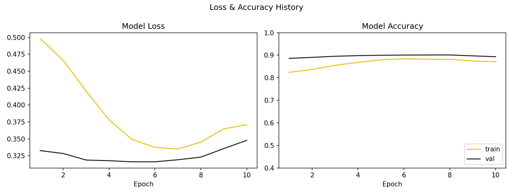

# VGG19 Transfer Learning — CIFAR-10

→ **[View the executed notebook (HTML)](./transfer_learning_vgg19.html)**

Feature-extraction transfer learning: a pretrained VGG19 (ImageNet weights) with its
convolutional base frozen and a new classifier trained on top, to classify CIFAR-10's
10 classes.

**Source**: adapted from the [Hugging Face Computer Vision Course](https://huggingface.co/learn/computer-vision-course/unit0/welcome/TableOfContents)
(MIT License, Copyright (c) 2023 Johannes Kolbe — see [../LICENSE](../LICENSE)).

## Result

10 epochs, Adam (lr=1e-4), `CosineAnnealingLR`. Best checkpoint (lowest validation loss,
epoch 5) reached **89.98% validation accuracy** on CIFAR-10; peak validation accuracy
during the run was 90.12% (epoch 8). A held-out CIFAR-10 test image (label: cat, never
seen during training) was correctly classified as "cat" at inference time.

Loss ticks back up from epoch 6 onward — not overfitting, but a scheduler mismatch:
`CosineAnnealingLR(T_max=5)` was used for a 10-epoch run, so the learning rate bottoms
out at epoch 5 and rises back up symmetrically for the rest of training (confirmed by
recomputing the logged `current_lr` values by hand). Fix: set `T_max=10`, or use a
scheduler with restarts.

## Bugs found and fixed in the original tutorial

1. **Classifier head never actually resized.** `pre_vgg19.classifier[6].out_features = NUM_CLASSES`
   only overwrites the attribute — the underlying `nn.Linear` weight matrix stays
   `(1000, 4096)`. Fixed by replacing the layer outright:
   `pre_vgg19.classifier[6] = nn.Linear(4096, NUM_CLASSES)`.
2. **Title/image rendered as two disconnected figures.** `visualize_model_predictions`
   built the title on a separate `plt.subplot()` figure from the one `imshow()` creates
   internally. Fixed by passing the title straight into `imshow(img, title=...)`.
3. **`CosineAnnealingLR(T_max=5)` mismatched to a 10-epoch run** — see Result above.
4. Kaggle-only inference image path replaced with a real held-out CIFAR-10 image.

## Setup

- Dataset: CIFAR-10 (50,000 train / 10,000 validation images, 10 classes, balanced)
- Model: `torchvision.models.vgg19(weights='IMAGENET1K_V1')`, convolutional base frozen
- Input size: 224x224 (resized from CIFAR-10's native 32x32)
- Batch size: 128, Adam optimizer (lr=1e-4), CosineAnnealingLR scheduler
- Ran on a local RTX 3080 GPU server (PyTorch 2.9.1+cu128) instead of Colab
